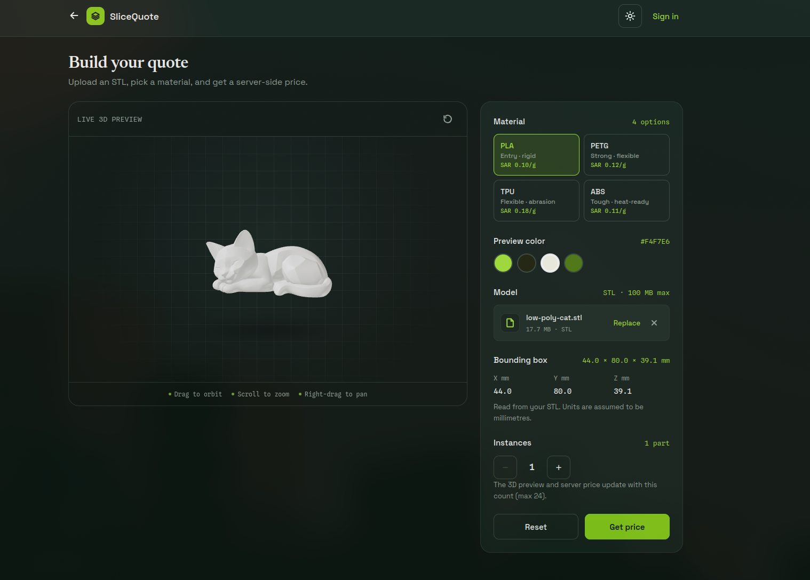
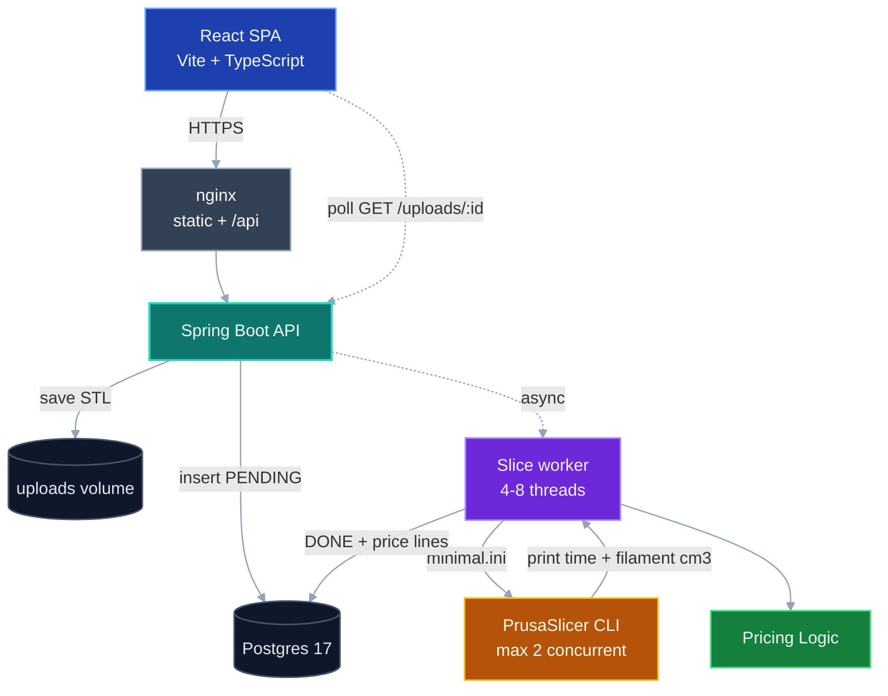

<p align="center">
  
</p>

<p align="center">
  Pick a material, upload an STL, get a priced estimate back.
</p>


## Intro
SliceQuote is a self-hostable quoting service for 3D printing. It slices every
upload with PrusaSlicer, turns the result into material and machine costs, and
returns an itemized estimate.


## Visuals
| Landing page | Quotation page |
| :---: | :---: |
|  |  |


## Architecture




## Download

```bash
git clone https://github.com/AbdulkaderBaghaffar/slicequote.git
cd slicequote
docker compose up -d
```

Open <http://localhost:3000>. 


## Tech Stack

| **Component** | **Technology** | **Description** |
|---|---|---|
| **Frontend** |  | React 19, TypeScript, Vite, and three.js power the quote flow, the UI, and the live 3D STL preview. |
| **API** |  | Java 21 and Spring Boot 4.1 expose auth, materials, uploads, repricing, and quote history over REST. |
| **Database** |  | PostgreSQL 17 stores materials, rates, uploads, and quote lines. |
| **Delivery** |  | Docker Compose runs the stack, nginx proxies `/api`, GitHub Actions publishes images to GHCR. |
