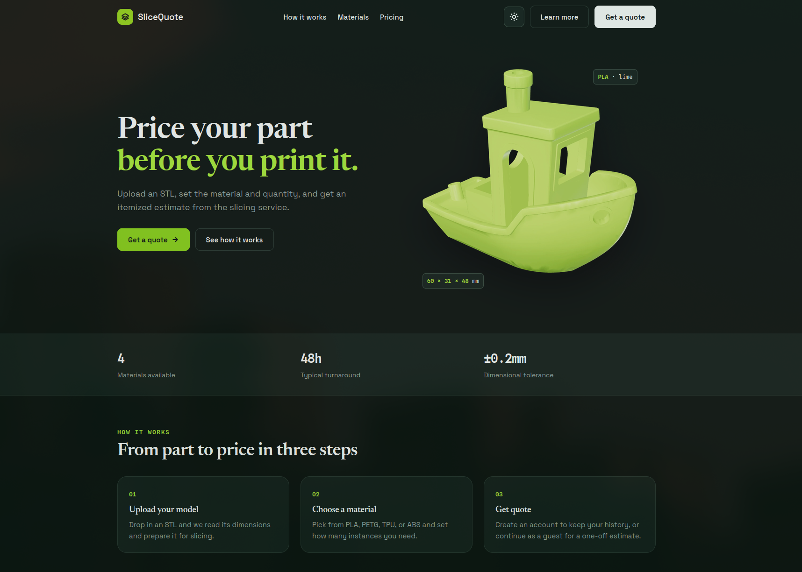

<p align="center">
  
</p>

<p align="center">
  Pick a material, upload an STL, get a priced estimate back.
</p>

SliceQuote is a self-hostable quoting service for 3D printing. It slices every
upload with PrusaSlicer, turns the result into material and machine costs, and
returns an itemized estimate — with a live 3D preview and saved quote history.

<!-- Screenshots: drop the images at docs/screenshots/landing.png and docs/screenshots/quote.png -->
| Landing page | Quotation page |
| :---: | :---: |
|  |  |

## Quickstart

Requires Docker with Compose v2 — nothing else. The image ships PrusaSlicer, and
the database seeds itself on first boot.

```bash
git clone https://github.com/AbdulkaderBaghaffar/slicequote.git
cd slicequote
docker compose up -d
```

Open <http://localhost:3000>. The first boot takes about a minute while Postgres
initialises and Flyway loads materials and pricing.

```bash
docker compose down       # stop
docker compose down -v    # stop and wipe the database + uploads
docker compose pull       # update to the latest published images
```

Port 3000 already in use? `WEB_PORT=3001 docker compose up -d`.

`./start.sh` does the same and prints the URL once the app is healthy.

## API

See [docs/api.md](docs/api.md) for the HTTP contract (endpoints, error shape, upload lifecycle).

## Development

Build both images from source instead of pulling the published ones:

```bash
docker compose -f docker-compose.yml -f docker-compose.build.yml up -d --build
```

### Web client

The React frontend lives in [`web/`](web/) (Vite + React + TypeScript) and
implements the Acid/Forest quotation design. It talks to this API for signup /
login, materials, STL upload, slicing status, and price breakdowns.

```bash
cd web
npm install
npm run dev      # http://localhost:5173 (CORS default)
npm run build    # type-check + production bundle
npm run preview  # http://localhost:4173
```

The API URL defaults to `http://localhost:8080` for development; override it with
`VITE_API_URL` in `web/.env.local`. The production image builds with
`VITE_API_URL=/api` and nginx proxies it to the backend.

### Production

The Cloudflare tunnel must target `http://web:80`; enable it with
`docker compose --profile tunnel up -d`. See
[docs/deployment.md](docs/deployment.md) for the full deployment, environment
overrides, backups, and troubleshooting guide.

---


## Stack

- **Java 21 + Spring Boot** 
- **React 19 + Vite + TypeScript** (`web/`)
- **Postgres 17**
- **JWT** 
- **PrusaSlicer CLI**
- **Docker** 
- **GitHub Actions**
- Deployed on **Home Server** 

## Architecture

A layer only talks to the layer below it.

| Layer | Package | Job |
|---|---|---|
| Controller | `controller/` | HTTP only: JSON in, JSON + status out |
| Service | `service/` | Business rules (pricing, ownership, lifecycle) |
| Worker | `worker/` | Async slice job, status transitions |
| Slicer | `slicer/` | The **only** class touching `ProcessBuilder` |
| Repository | `repository/` | DB access (Spring generates the impls) |
| Entity | `data/` | Stored rows (JPA lives in `data`, not `entity`) |
| DTO | `dto/` | Request/response shapes at the API boundary |
| Config | `config/` | Beans, security rules, `@ControllerAdvice` |
